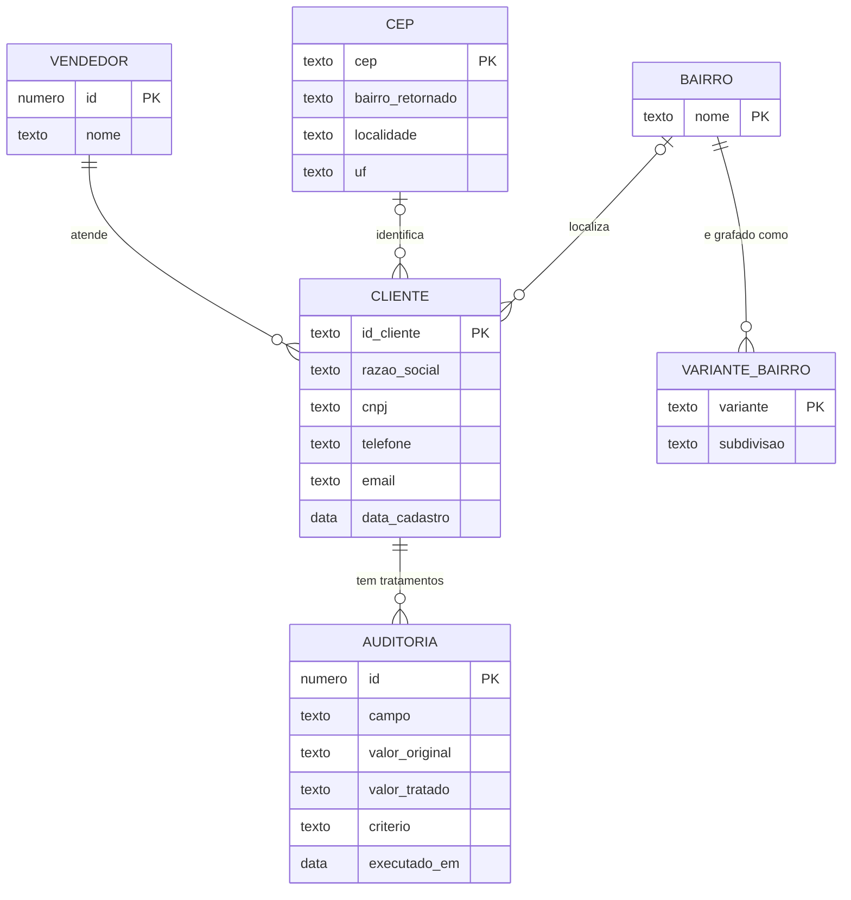
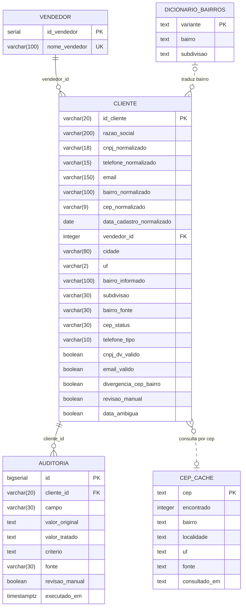

# Modelo de dados (MER + DER)

Os diagramas usam Mermaid e são renderizados automaticamente pelo GitHub.

## MER — modelo conceitual

Entidades do negócio e seus relacionamentos, sem decisões de implementação.

Leitura das cardinalidades:

- Um cliente tem no máximo um bairro e no máximo um CEP (o CLI0047 não tem nenhum dos dois). Um CEP serve a vários clientes: na base há 14 CEPs válidos distintos, 10 deles compartilhados.
- Cada cliente tem exatamente um vendedor; um vendedor atende vários clientes.
- Cada cliente tem vários registros de auditoria (valor original → valor tratado → critério).
- Cada bairro canônico pode ser escrito de várias formas (dicionário de variantes).

## DER — modelo lógico (banco relacional)

Tabelas criadas pelas migrações do Django. Os nomes físicos são `clientes_vendedor`,
`clientes_cliente` e `clientes_auditoria`.

### Como o MER vira o DER

| Entidade conceitual | Implementação |
|---|---|
| Vendedor | Tabela própria `clientes_vendedor` (exigida pela API) |
| Cliente | Tabela `clientes_cliente`, com FK `vendedor_id` (`ON DELETE PROTECT`) |
| Bairro e CEP | Colunas `bairro_normalizado` e `cep_normalizado` do cliente. Desnormalização intencional: a base é voltada a relatórios agrupados por bairro |
| Auditoria | Tabela `clientes_auditoria`, com FK real para o cliente (`ON DELETE CASCADE`). Aparece só no admin, não na API |
| Variante de bairro | Arquivo `etl/dicionario_bairros.csv`, fora do banco |
| Cache de CEP | Arquivo SQLite local `cache/cep_cache.sqlite`, fora do banco |

As colunas depois de `vendedor_id` na tabela de cliente são metadados do ETL: aparecem no admin
e não são expostas na API.
